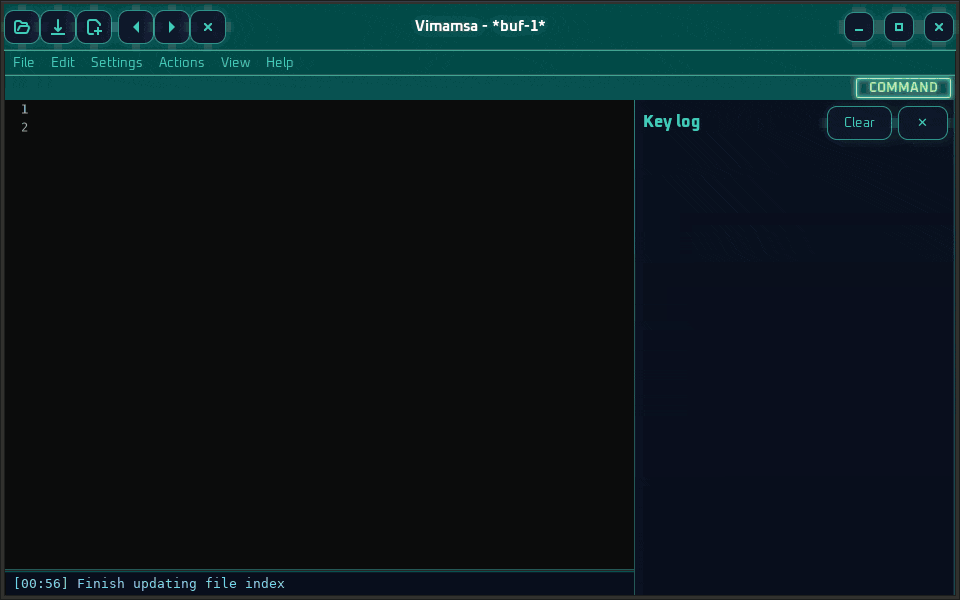

# Vimamsa

Vi/Vim -inspired experimental GUI-oriented text editor written with Ruby and GTK.

<!-- toc -->

- [Download (AppImage)](#download-appimage)
- [Install as a Ruby gem](#install-as-a-ruby-gem)
  * [Other install options](#other-install-options)
- [Run](#run)
- [Demo](#demo)
- [Key bindings](#key-bindings)
- [Current limitations](#current-limitations)

<!-- tocstop -->

## Download (AppImage)

The easiest way: one file, nothing to install (Ruby, GTK and everything else
the editor needs are inside it).

1. Download [Vimamsa-x86_64.AppImage](https://github.com/SamiSieranoja/vimamsa/releases/latest/download/Vimamsa-x86_64.AppImage)
   (all versions: [Releases](https://github.com/SamiSieranoja/vimamsa/releases)).
2. Make it executable and run it:
   ```
   chmod +x Vimamsa-x86_64.AppImage
   ./Vimamsa-x86_64.AppImage [file]
   ```
   (or in the file manager: Properties ▸ "Allow executing file as program", then
   double-click it).

On the first start it adds Vimamsa to the application menu. If you move the
file, start it once from the new place to update the menu entry. To update, download the new
version over the old file.

Requirements: x86_64 Linux with glibc 2.39 or newer: Ubuntu 24.04, Linux Mint 22,
Fedora 40, Debian 13, Arch, openSUSE Tumbleweed or newer. On an older system it
stops at start with `GLIBC_2.39 not found`; use the gem install below instead.
If your home directory is mounted `noexec`, move the file to a place where programs
can run.

The AppImage is built by [GitHub Actions](.github/workflows/appimage.yml) from the
tagged source. To check that a downloaded file came from this repository's build
(needs the [GitHub CLI](https://cli.github.com/)):
```
gh attestation verify Vimamsa-x86_64.AppImage --repo SamiSieranoja/vimamsa
```

## Install as a Ruby gem

Requirements:
 - Ruby 3.2+
 - GTK 4

On Ubuntu (24.04):
```
sudo apt install ruby-dev build-essential pkg-config \
  libgtk-4-dev libgtksourceview-5-dev libvte-2.91-gtk4-dev \
  libgstreamer1.0-dev libgstreamer-plugins-base1.0-dev
sudo gem install vimamsa
```

Run:
```
vimamsa
```

### Other install options

Install from sources:

```
git clone https://github.com/SamiSieranoja/vimamsa.git
cd vimamsa
gem build vimamsa.gemspec 
sudo gem install --local vimamsa-0.1.*.gem

```

## Run
```
vimamsa
```

Install packages for optional features:
```
sudo apt install ack-grep clang-format
```

For customization, edit ~/.vimamsa/custom.rb

## Demo



Moving with `h j k l` and `w e b`, `y y p`, `d d`, undo `u` / redo `ctrl-r`,
typing in Insert mode and back to Command mode with `ctrl` (press and release
it alone), selecting in Visual mode, and easy jump (`s`: type a word's label to
jump there). The key log panel on the right (View ▸ Toggle
key log panel) shows each key and the action it ran.

The editor plays this demo and others itself: the introduction page (shown on
the first start, and from Help ▸ Introduction) has a button for each. It also
links to a one-screen summary for Vim users (Help ▸ Vimamsa for Vim users).
`vimamsa --intro` shows the introduction page at start whatever the settings
say.

## Key bindings

The default keybinding scheme, "vimlike", is close to Vim. It keeps the Vim
bindings and changes a few keys for its own features. For the full list, see
the menu item "Help ▸ Show key bindings" and the file
lib/vimamsa/key_bindings_vimlike.rb. You can switch the scheme in Settings
("Keybinding scheme", applied after a restart) or with
`cnf.keybindings.scheme = "vim"` in ~/.config/vimamsa/settings.rb:

 - `vimlike` (default): Vim keys plus the extra bindings below
 - `vim`: plain Vim bindings
 - `notepad`: non-modal, stays in insert mode (gedit/notepad style)

Keys that work much like in Vim:

In Command mode:
```
h j k l w b e W B E 0 ^ $ gg G <count>G f F t T ; * / n N : gf g;
i a A I o J p P D Y S u ctrl-r . x ~ r<char> R v m<char> '<char> `<char>
q<char> @<char> "<char> ctrl-f ctrl-b ctrl-d ctrl-u ctrl-a
```
Operators `d c y gU gu g~ > <` combine with the motions above and with text
objects (`iw aw i( a" it ...`), e.g. `d w`, `c i w`, `y y`, `> >`.

In Visual mode:
```
d x y c J u U ~ gU gu > < iw aw ...
```

The keys that work differently from Vim are listed in the tables below
(the full list of conflicts is in doc/vimlike_vim_conflicts.md).

Syntax:

 - `ctrl!` means press and immediately release the ctrl key. Triggered by the key up event when no other keys were pressed between the key down and key up events.
 - `ctrl-x` means press and hold the ctrl key, press x.
 - `, a` means press `,`, then `a`.

**Command mode**

| Key | Action |
|---|---|
| `ctrl!` | Switch between command and insert modes |
| `shift!` `s` | Save file (press and release shift, then `s`) |
| `s` | Easy jump (similar to Vim [EasyMotion](https://github.com/easymotion/vim-easymotion)): type a word's label to jump there |
| `z` | Enter BROWSE mode |
| `O` | Move to end of line |
| `X` | Insert an empty line below |
| `C` | Search in files (grep) |
| `tab` | Switch between current and previous buffer |
| `M` | Run the last recorded macro |
| `enter` | On a link: open url in browser. On `/path/to/file.txt:linenum`: open the file, jump to linenum |
| `space <char>` | Insert character `<char>` |
| `ctrl-o` | Open file |
| `ctrl-s` | Save file |
| `ctrl-w` | Close buffer |
| `ctrl-c` / `ctrl-x` | Comment / uncomment line |
| `ctrl-q` | Quit |
| `g s` | Jump to a file in the file panel by its label |
| `alt-h` / `alt-l` | Previous / next file in the file panel |
| `, b` | Switch buffer (buffer manager) |
| `, f` | File explorer: browse directories (`h` parent directory, `l` or `enter` open) |
| `, , f` or `, z` | File finder (fuzzy search for file names) |
| `, h` | File history |
| `, g` | Search for a string in the current buffer, show matching lines |
| `, a` | Search in files using ack |
| `, r r` | Search and replace |
| `, e` or `:` | Command line |
| `, s a` | Save as |
| `, n b` | New buffer |
| `, c b` | Close buffer |
| `, r v b` | Revert buffer from disk |
| `, M` / `, '` | Add bookmark / list bookmarks |
| `, v` | Auto-indent buffer |
| `, w` | Switch between columns |
| `, , w` | Toggle two-column view |
| `, m h` | Show messages |

**Insert mode** (similar to bash or emacs)

| Key | Action |
|---|---|
| `ctrl!` or `esc` | Switch to command mode |
| `ctrl-n` / `ctrl-p` | Move to next / previous line |
| `ctrl-a` / `ctrl-e` | Move to beginning / end of line |
| `ctrl-b` / `ctrl-f` | Move backward / forward one char |
| `alt-b` / `alt-f` | Move backward / forward one word |
| `ctrl-d` | Delete to end of word |
| `ctrl-z` / `ctrl-y` | Undo / redo |
| `ctrl-c` / `ctrl-x` / `ctrl-v` | Copy / cut / paste |
| `shift-<arrow>` | Select |
| `ctrl-l` / `ctrl-g` | Search in buffer / next match |
| `ctrl-space` or `ctrl-h` | Show completions (`tab` / `shift-tab` to choose, `shift!` to accept) |
| `alt-s` | Easy jump |
| `ctrl-s` | Save file |

**Visual mode**

| Key | Action |
|---|---|
| `ctrl!` or `esc` | Exit visual mode |
| `s` | Easy jump: extend the selection to a word's label |
| `tab` / `shift-tab` | Indent / unindent selection |
| `ctrl-c` / `ctrl-x` | Comment / uncomment selection |
| `a y` / `a d` | Copy / delete, appending to the clipboard |
| `g c` / `g s` | Capitalize / swap case |
| `g r` | Reverse selection |
| `g w` | Remove extra spaces |
| `, t b` / `, t i` / `, t l` | Bold / italic / link (hyperplaintext) |

**Browse mode** (enter with `z`)

| Key | Action |
|---|---|
| `h` / `l` | Previous / next buffer in history |
| `q` / `w` | Previous / next edited position |
| `p` / `n` | Previous / next file in the file panel |
| `s` / `d` | Page up / down |
| `e` / `r` | Quarter page up / down |
| `i` / `o` | Start / end of buffer |
| `z` | Center the current line, back to command mode |
| `m` | Run the last recorded macro |
| `c` | Close buffer |
| `j`, `esc`, `enter` or `ctrl!` | Back to command mode |

Bindings can be customized in ~/.config/vimamsa/custom.rb.
For example, to bind ctrl-n to action "create new file":
```
bindkey 'C ctrl-n', 'buf.new'
```

custom.rb is loaded in two phases. The body of the file runs early, before
modules are initialized, so that the settings it makes (cnf.\*) are visible to
them. Modes that are created by modules (e.g. "fexp" for the file selector,
"grep") do not exist yet at that point; bindings for those go in an optional
function `hook_custom_after_init`, which is called after everything is loaded:
```
def hook_custom_after_init
  bindkey 'fexp , x', :my_action
end
```


## Known issues
 - Cursor sometimes vanishes when dragging or resizing the window. At least some cases are fixed in new GTK4 versions ( >= 4.18, in Ubuntu Ubuntu 25.04). Workaround is to press ctrl key twice.

## Current limitations
 - Linux only
 
Mainly tested with:
 - UTF8, English or Finnish
 - Line endings with "\n"


